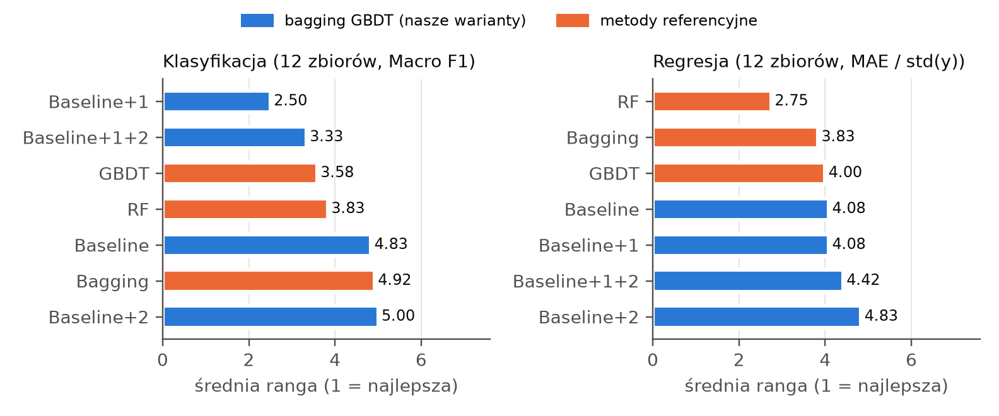

# Adaptive Bagged Boosting – podsumowanie wyników

**Materiał do omówienia** · Ensemble Learning, Research Project 2026/2027 · Politechnika Warszawska

**Autorzy:** Mykhailo Shamrai, Grzegorz Prasek · **Prowadzący:** Stanisław Kaźmierczak · **Data:** 24.11.2026

## 1. Co badaliśmy

Bagging B modeli Gradient Boosting (GBDT, scikit-learn) z dwiema modyfikacjami:

- **(1) Adaptive Sampling** – próbki dla kolejnych modeli losowane z wagami w_i = 1 + α·e_i + β·d_i, gdzie e_i to błąd, a d_i rozbieżność predykcji out-of-bag dotychczasowego zespołu,
- **(2) Ensemble-Aware Early Stopping** – liczba drzew każdego GBDT dobierana na podstawie straty **całego zespołu** na walidacji wewnętrznej.

Porównujemy 4 warianty (Baseline, +1, +2, +1+2) z GBDT, baggingiem drzew i Random Forest na **24 zbiorach UCI** (12 klasyfikacyjnych, 12 regresyjnych). Procedura: 2×5-krotna walidacja krzyżowa, w każdym foldzie strojenie losowe (8 konfiguracji na metodę, wspólne losowanie dla wariantów), test Friedmana i testy Wilcoxona z korektą Holma. Łącznie 1680 przebiegów, 0 błędów. Dodatkowo (23.11): szum w etykietach 10%/20% i ablacja sygnałów Adaptive Sampling – 4600 przebiegów na 23 zbiorach.

## 2. Najważniejsze wyniki

*Rysunek 1. Średnie rangi metod (1 = najlepsza). Klasyfikacja: Macro F1, regresja: MAE / std(y).*

| Hipoteza | Werdykt | Dowód |
|---|---|---|
| **H1** – Adaptive Sampling poprawia jakość i stabilność | **tak w klasyfikacji**, nie w regresji | klasyfikacja: lepiej na 11/12 zbiorów, p = 0,006 (Holm), średnio +0,9% F1, najlepsza ranga spośród 7 metod (2,50); regresja: 7/5 zbiorów, brak efektu; stabilność: mniejsze odchylenie na 9/12 i 10/12 zbiorów |
| **H2** – Early Stopping obniża koszt bez straty jakości | **tak**, z zastrzeżeniem | ok. 18% mniej drzew i 10% krótszy trening; brak istotnej zmiany jakości; w regresji lekka tendencja w dół (gorzej na 10/12 zbiorów, ale o ok. 0,1%) |
| **H3** – połączenie daje najlepszy kompromis | **nie** | +1+2 nie jest istotnie lepsze ani od +1, ani od Baseline; daje kompromis pośredni |

**Inne obserwacje:**

- **Sam bagging GBDT nie bije pojedynczego GBDT** (gorszy na 9/12 zbiorów klasyfikacyjnych) przy ok. 7× większym koszcie. Przewagę nad GBDT daje dopiero Adaptive Sampling.
- **W regresji wygrywa Random Forest** (ranga 2,75). Przewaga jest duża na zbiorach z wieloma obserwacjami i niewieloma cechami (CCPP, Airfoil, Wine Quality: błąd niższy o 13–18%). Na zbiorach o gładkiej zależności (Yacht, Energy, Concrete) wygrywa GBDT.
- **Oszczędność Early Stopping silnie zależy od zbioru** – od 52% drzew (Forest Fires) do 0% (CCPP, Car, Banknote), gdzie zespół poprawia się aż do limitu M = 200.
- **Strojenie najczęściej wybierało górne granice przestrzeni** (M = 200, max_depth = 3, learning_rate = 0,1). Przestrzeń z planu była prawdopodobnie za wąska.

### Eksperyment dodatkowy: szum w etykietach i ablacja

Warianty ablacji: **(e)** – wagi tylko z błędu (β = 0), **(d)** – tylko z rozbieżności (α = 0). Szum w części treningowej i walidacyjnej, test czysty.

| | Klasyfikacja (11 zbiorów) | Regresja (12 zbiorów) |
|---|---|---|
| Bez szumu | zysk daje **błąd e_i**: (e) lepszy od (d) na 9/11 zbiorów | brak efektu żadnego sygnału |
| Szum 10–20% | zysk Adaptive Sampling znika; (d) najlepszy z wariantów BaggedGBDT (różnice nieistotne) | **Baseline+1 gorszy od Baseline na 11/12 zbiorów (p ≤ 0,01, Holm)**; przyczyną jest e_i: **(d) lepszy od (e) na 12/12 zbiorów przy obu poziomach szumu (p = 0,002)** |

- **Mechanizm:** obserwacja z błędną etykietą ma duży błąd OOB, więc Adaptive Sampling losuje ją częściej i zespół uczy się szumu. Rozbieżność d_i nie zależy od etykiety, więc szumu nie wzmacnia. Strojenie nie wybiera par z przewagą β, bo walidacja jest tak samo zaszumiona.
- **Early Stopping** oszczędza przy szumie więcej (klasyfikacja: 59% drzew przy 20% szumu, wobec 81% bez szumu), ale nie chroni przed uczeniem się szumu (+1+2 ≈ +1).
- **Bagging GBDT jest odporniejszy od GBDT** (spadek F1 przy 20% szumu: 6,9% vs 9,1%); najodporniejszy jest RF.

## 3. Ograniczenia obecnego badania

12 zbiorów na zadanie daje niską moc testów (brak istotności nie oznacza braku efektu). Wąska przestrzeń strojenia (8 konfiguracji, M ≤ 200, max_depth ≤ 3) może zaniżać wyniki GBDT i naszych wariantów, szczególnie w regresji, i ogranicza oszczędność Early Stopping. Wariant bazowy jest kosztowny (B pełnych modeli GBDT), a implementacja w scikit-learn nie skaluje się na duże zbiory.

## 4. Możliwe kierunki dalszej pracy

Kierunki uporządkowane od najbliższych obecnym wynikom. Szum i ablację, proponowane we wcześniejszej wersji, już wstępnie zbadaliśmy (wyżej); wynikają z nich kierunki 1–3.

1. **Adaptive Sampling odporny na szum** – wagi łączące oba sygnały tak, by nie wzmacniać obserwacji z dużym błędem i małą rozbieżnością (kandydat na błędną etykietę), wagi z rang lub obcięte na kwantylu, albo α/β dobierane do oszacowanego poziomu szumu. Cel: zachować zysk e_i na czystych danych i odporność d_i przy szumie.
2. **Szersza analiza szumu** – więcej poziomów (5–40%), szum zależny od klasy/cech, porównanie z metodami filtrowania szumu i z ważeniem w boostingu odpornym na szum.
3. **Ablacja dla klasyfikacji z większą mocą** – więcej zbiorów (np. OpenML-CC18), bo różnice (e) vs (d) w klasyfikacji są kierunkowe, ale nieistotne.
4. **Early Stopping na poziomie liczby modeli B** – zatrzymanie dodawania modeli, gdy zespół przestaje się poprawiać. Naturalne rozszerzenie idei „ensemble-aware”, potencjalnie większa oszczędność niż przycinanie drzew.
5. **Analiza różnorodności zespołu** (rozbieżność, statystyka Q, dekompozycja obciążenie–wariancja) – wyjaśnienie, *dlaczego* Adaptive Sampling działa w klasyfikacji.
6. **Zbiory niezbalansowane** – największy zysk wyszedł na Glass (+5,1% F1); porównanie z ważeniem klas.
7. **Szersze strojenie i szybsza implementacja** (HistGradientBoosting / LightGBM, M do 500–1000) oraz większy benchmark (np. OpenML-CC18) – większa moc testów i weryfikacja wyniku dla regresji.

## 5. Do decyzji: kontynuacja tematu

**Argumenty za kontynuacją:**

- istotny pozytywny wynik (Adaptive Sampling w klasyfikacji) i **wyjaśniony mechanizm z eksperymentu dodatkowego**: sygnał błędu daje zysk na czystych danych, ale wzmacnia szum (istotnie, 11/12 zbiorów), a sygnał rozbieżności jest odporny (12/12) – to oś możliwego artykułu („error vs. divergence signals in adaptive resampling for bagged boosting”),
- gotowa, przetestowana infrastruktura (24 zbiory, CV ze strojeniem, analiza statystyczna) – nowe eksperymenty to głównie nowe konfiguracje,
- kierunek 1 (wagi odporne na szum) to naturalna nowa metoda wynikająca z wyników, a kolejne eksperymenty są tanie (2,7 h dla całego eksperymentu z szumem).

**Ryzyko:**

- efekt jest mały (średnio +0,9% F1), a połączenie modyfikacji (H3) nie zadziałało,
- zysk bez szumu jest mały i nieistotny względem GBDT; RF pozostaje najlepszy przy szumie, więc metoda odporna na szum musi go co najmniej dogonić.

**Propozycja:** kontynuować z zawężonym zakresem – Adaptive Sampling jako główna metoda, kierunki 1–3 (odporność na szum i rola sygnałów błędu i rozbieżności), ewentualnie 4.
