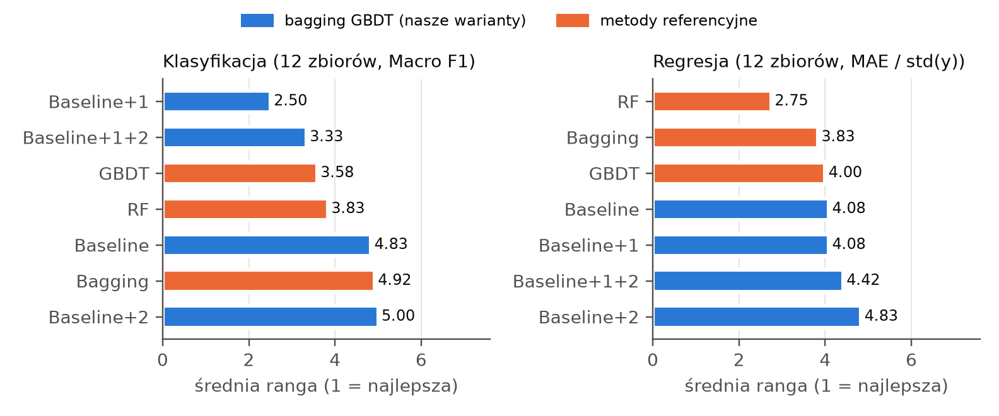
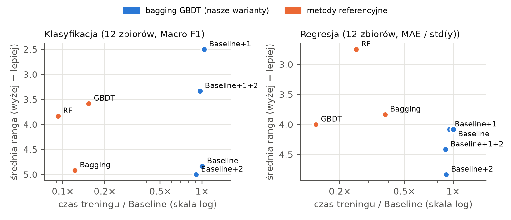
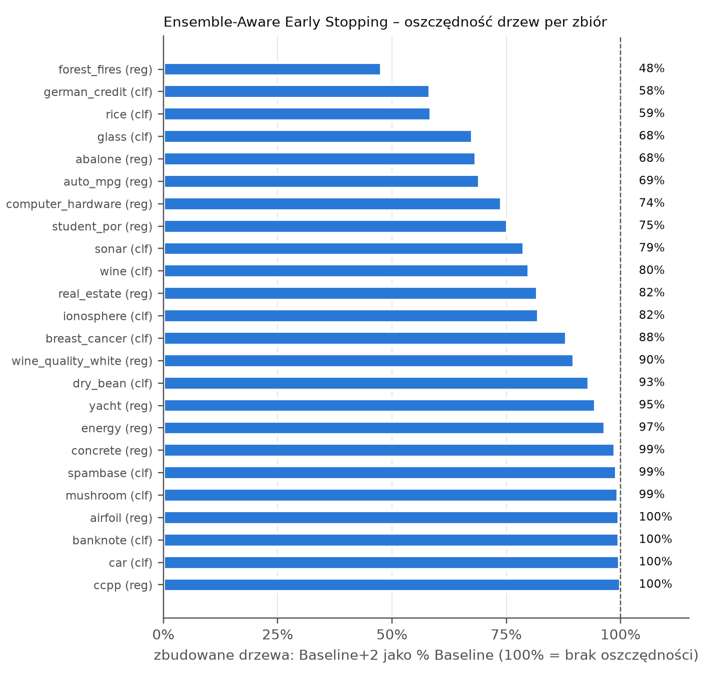
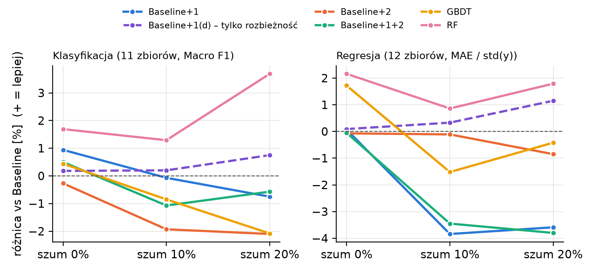

# Adaptive Bagged Boosting: Adaptive Sampling i Ensemble-Aware Early Stopping

**Raport końcowy** · Ensemble Learning, Research Project 2026/2027 · Politechnika Warszawska

**Autorzy:** Mykhailo Shamrai, Grzegorz Prasek · **Prowadzący:** Stanisław Kaźmierczak · **Data:** 24.11.2026

## Streszczenie

Badamy bagging modeli Gradient Boosting (BaggedGBDT) z dwiema modyfikacjami: **Adaptive Sampling**, który losuje próbki dla kolejnych modeli z wagami zależnymi od błędu i rozbieżności predykcji out-of-bag dotychczasowego zespołu, oraz **Ensemble-Aware Early Stopping**, który dobiera liczbę drzew każdego modelu na podstawie straty całego zespołu na walidacji. Cztery warianty (Baseline, +1, +2, +1+2) porównujemy z GBDT, baggingiem drzew i Random Forest na 24 zbiorach UCI (12 klasyfikacyjnych, 12 regresyjnych), stosując 2×5-krotną walidację krzyżową ze strojeniem hiperparametrów w każdym foldzie. Adaptive Sampling istotnie poprawia Macro F1 w klasyfikacji (lepszy wynik na 11 z 12 zbiorów, p = 0,006 po korekcie Holma; najlepsza średnia ranga wśród 7 metod), ale nie poprawia jakości w regresji. Early Stopping zmniejsza liczbę budowanych drzew o ok. 18% i czas treningu o ok. 10% bez istotnej zmiany jakości. Połączenie obu modyfikacji nie przewyższa każdej z nich osobno. W regresji najlepszy okazał się Random Forest. W eksperymencie dodatkowym z 10% i 20% szumu w etykietach oraz ablacją Adaptive Sampling pokazujemy, że zysk w klasyfikacji pochodzi z sygnału błędu e_i, ale ten sam sygnał przy zaszumionych etykietach wzmacnia szum: w regresji pogarsza wynik na 11 z 12 zbiorów (p ≤ 0,004 po korekcie Holma). Wariant oparty wyłącznie na rozbieżności d_i jest odporny na szum i przy obu poziomach szumu jest lepszy od wariantu opartego na błędzie na wszystkich 12 zbiorach regresyjnych.

## Spis treści

1. Problem badawczy
2. Podstawy teoretyczne i przegląd literatury
3. Proponowana metoda
4. Eksperymenty (zbiory danych, walidacja, strojenie, metryki, pilotaż)
5. Wyniki (jakość, stabilność, koszt, szum w etykietach i ablacja)
6. Dyskusja
7. Wnioski
8. Zmiany względem planu
9. Wykorzystanie narzędzi AI
10. Uruchomienie kodu i odtworzenie wyników

Literatura

## 1. Problem badawczy

Bagging trenuje wiele modeli na próbkach bootstrapowych i uśrednia ich predykcje, co przede wszystkim zmniejsza wariancję. Boosting buduje modele sekwencyjnie, a każdy kolejny poprawia błędy poprzednich, co zmniejsza obciążenie, ale zwiększa wrażliwość na szum. W projekcie łączymy oba podejścia: trenujemy B modeli Gradient Boosting (GBDT) na próbkach bootstrapowych i uśredniamy ich predykcje (w klasyfikacji – prawdopodobieństwa klas). Na tej wspólnej architekturze badamy dwie modyfikacje:

1. **Adaptive Sampling** (modyfikacja 1) – próbki dla kolejnych modeli losujemy z prawdopodobieństwami zależnymi od błędu i rozbieżności predykcji dotychczasowego zespołu.
2. **Ensemble-Aware Early Stopping** (modyfikacja 2) – liczbę iteracji każdego GBDT dobieramy na podstawie jakości **całego zespołu** na walidacji, a nie samego modelu.

Porównujemy cztery warianty: Baseline (bagging GBDT), Baseline+1, Baseline+2 i Baseline+1+2, a jako punkty odniesienia pojedynczy GBDT, bagging drzew decyzyjnych i Random Forest. Weryfikujemy hipotezy z planu projektu:

- **H1** – Adaptive Sampling poprawia jakość i stabilność predykcji.
- **H2** – Ensemble-Aware Early Stopping zmniejsza koszt obliczeniowy bez istotnego pogorszenia jakości.
- **H3** – połączenie obu modyfikacji daje lepszy kompromis jakość–stabilność–koszt niż każda z nich osobno.

## 2. Podstawy teoretyczne i przegląd literatury

### 2.1. Podstawy teoretyczne

**Zespoły modeli.** Błąd oczekiwany modelu można rozłożyć na obciążenie (systematyczne odchylenie od prawdziwej zależności), wariancję (wrażliwość na konkretną próbkę uczącą) i szum nieredukowalny. Zespół łączy predykcje wielu modeli; zyskuje tym więcej, im bardziej modele są trafne i jednocześnie różnorodne, tzn. mylą się na różnych obserwacjach.

**Bagging** (bootstrap aggregating) trenuje modele na próbkach bootstrapowych – n obserwacji losowanych ze zwracaniem – i uśrednia ich predykcje. Każda próbka pomija średnio ok. 36,8% obserwacji; są to obserwacje **out-of-bag (OOB)** danego modelu, które pozwalają ocenić model bez osobnego zbioru. Uśrednianie zmniejsza przede wszystkim wariancję, dlatego bagging działa najlepiej z modelami niestabilnymi, np. głębokimi drzewami. **Random Forest** dodatkowo losuje podzbiór cech w każdym podziale drzewa, co zwiększa różnorodność.

**Boosting** buduje modele sekwencyjnie, a każdy kolejny koncentruje się na błędach poprzednich, co zmniejsza głównie obciążenie. **Gradient Boosting (GBDT)** w każdej iteracji dopasowuje płytkie drzewo regresyjne do ujemnego gradientu funkcji straty (w regresji kwadratowej – do reszt) i dodaje je do modelu z mnożnikiem learning_rate. Liczba iteracji M kontroluje dopasowanie: zbyt duża prowadzi do przeuczenia, stąd zatrzymywanie na walidacji (early stopping).

**Bagging modeli boostingowych** łączy oba mechanizmy: każdy GBDT ma niskie obciążenie, a uśrednianie wielu takich modeli zmniejsza wariancję. Kosztem jest B-krotnie dłuższy trening. Nasze modyfikacje dotyczą dwóch elementów tego schematu: sposobu losowania próbek (zamiast jednostajnego – zależnie od trudności obserwacji dla dotychczasowego zespołu) i liczby iteracji każdego modelu (zamiast stałej – zależnie od wkładu modelu w jakość całego zespołu).

### 2.2. Przegląd literatury

- **MultiBoosting** (Webb, 2000) [1] łączy boosting z waggingiem (wariantem baggingu z losowymi wagami) – punkt odniesienia dla naszego wariantu bazowego.
- **Vote-Boosting** (Sabzevari i in., 2018) [2] uzależnia wagi przykładów od stopnia zgodności głosów zespołu. Nasz Adaptive Sampling korzysta z podobnej idei rozbieżności, ale łączy ją z błędem zespołu i steruje losowaniem próbek bootstrapowych dla kolejnych modeli GBDT.
- **agtboost** (Lunde i Kleppe, 2020) [3] automatycznie dobiera złożoność GBDT, w tym liczbę drzew, dla pojedynczego modelu. Nasze zatrzymywanie dotyczy wpływu modelu na jakość całego zespołu.
- **MP-Boost** (Toghani i Allen, 2021) [4] łączy adaptacyjne próbkowanie obserwacji i cech z zatrzymywaniem na walidacji out-of-patch w ramach jednego zespołu słabych modeli. My stosujemy oba mechanizmy w baggingu wielu pełnych modeli GBDT.

## 3. Proponowana metoda

### 3.1. Architektura bazowa

Dla danych treningowych o n obserwacjach trenujemy sekwencyjnie B modeli GBDT. Model b dostaje próbkę n indeksów losowanych ze zwracaniem i buduje do M drzew o głębokości max_depth ze współczynnikiem uczenia learning_rate. Wewnętrzne losowanie obserwacji w GBDT jest wyłączone (subsample = 1), żeby nie mieszać go z badanym losowaniem zewnętrznym. Predykcja zespołu to średnia predykcji modeli: wartości w regresji, prawdopodobieństwa klas w klasyfikacji (klasa = argmax). Modele trenujemy po kolei, bo obie modyfikacje korzystają z modeli już wytrenowanych.

### 3.2. Modyfikacja 1: Adaptive Sampling

Model 1 dostaje zwykłą próbkę bootstrapową. Przed treningiem modelu b (b ≥ 2) dla każdej obserwacji i liczymy predykcje **out-of-bag (OOB)**: bierzemy wyłącznie te spośród modeli 1..b−1, których próbka nie zawierała obserwacji i. Dzięki temu sygnał nie jest zaniżony przez dopasowanie modelu do obserwacji, którą widział. Na tej podstawie wyznaczamy:

- **błąd e_i**: w regresji |y_i − ŷ_i^OOB|, w klasyfikacji 1 − p_i^OOB(prawdziwa klasa),
- **rozbieżność d_i**: w regresji odchylenie standardowe predykcji modeli OOB, w klasyfikacji średnia po klasach wariancji prawdopodobieństw (wymaga co najmniej 2 modeli OOB).

Oba sygnały normalizujemy do [0, 1], dzieląc przez kwantyl 99% (wśród obserwacji z sygnałem) i obcinając do 1 – pojedyncza obserwacja odstająca nie spłaszcza wtedy wag pozostałych. Wagi i prawdopodobieństwa losowania:

w_i = 1 + α·e_i + β·d_i,   P(i) = w_i / Σ_j w_j

Obserwacje bez żadnej predykcji OOB dostają w_i = 1. Waga mieści się w [1, 1 + α + β], więc trudna obserwacja jest losowana najwyżej (1 + α + β) razy częściej niż łatwa, a próbka nie zapada się na kilku przykładach. Predykcje OOB wykorzystujemy wyłącznie jako sygnał sterujący treningiem, a nie jako ocenę generalizacji.

### 3.3. Modyfikacja 2: Ensemble-Aware Early Stopping

Model b rośnie przyrostowo (warm start) po k drzew aż do limitu M. Po każdym przyroście (checkpoint) liczymy stratę **zespołu** złożonego z gotowych modeli 1..b−1 i bieżącej wersji modelu b na walidacji wewnętrznej. Predykcje gotowych modeli są zapamiętane, więc checkpoint kosztuje jedną predykcję bieżącego modelu. Checkpoint uznajemy za poprawę, gdy strata spadła o więcej niż 0,1% względem najlepszej dotychczasowej. Po p kolejnych checkpointach bez poprawy (albo po osiągnięciu M) kończymy trening i przycinamy model do liczby iteracji z najlepszego checkpointu. Iteracje boostingu są sekwencyjne, więc przycięty model jest identyczny z modelem trenowanym od razu na tylu iteracjach (sprawdza to test automatyczny).

Kryterium straty to log-loss w klasyfikacji i MAE w regresji. Macro F1 nie nadaje się do tej roli: na małej walidacji (np. 29 obserwacji w zbiorze Wine) zmienia się skokowo i często stoi w miejscu, co prowadziło do zbyt wczesnego zatrzymania.

### 3.4. Implementacja

Kod napisaliśmy w Pythonie z użyciem biblioteki scikit-learn (klasy `GradientBoostingClassifier/Regressor`, `BaggingClassifier/Regressor`, `RandomForestClassifier/Regressor`). Główne elementy:

- `src/models.py` – klasa `BaggedGBDT` z przełącznikami `adaptive_sampling` i `ensemble_es` (cztery warianty w jednej implementacji),
- `src/data.py` – pobieranie 24 zbiorów z UCI i przygotowanie danych,
- `src/evaluation.py`, `src/tuning.py` – walidacja krzyżowa, strojenie i metryki,
- `scripts/run_full.py`, `scripts/analyze.py`, `scripts/figures.py` – eksperymenty, analiza statystyczna i rysunki,
- `tests/` – 14 testów poprawności (m.in. przycinanie modelu, wybór checkpointu, rozłączność podziałów, brak wycieku przy uzupełnianiu braków, szum w etykietach).

## 4. Eksperymenty

### 4.1. Zbiory danych

Użyliśmy 24 zbiorów z UCI Machine Learning Repository zgodnie z planem (tabela 1). Przygotowanie danych: zmienne kategoryczne kodujemy one-hot (brak wartości w zmiennej kategorycznej to osobna kategoria; dotyczy kolumny stalk-root w Mushroom), braki w zmiennych liczbowych (6 w Auto MPG) uzupełniamy medianą liczoną wyłącznie z części treningowej foldu. Zgodnie z planem: Wine Quality – tylko wina białe; Student Performance – plik por, cel G3, bez G1 i G2; Energy Efficiency – cel Y1 (Heating Load); Computer Hardware – cel PRP, bez ERP i identyfikatorów producenta i modelu. Zbiór Yacht nie jest dostępny przez bibliotekę ucimlrepo, więc pobieramy go bezpośrednio z UCI.

**Tabela 1.** Zbiory danych (d – liczba cech przed i po kodowaniu one-hot, K – liczba klas)

| ID UCI | Zbiór | Zadanie | n | d | d po one-hot | K |
|---|---|---|---|---|---|---|
| 109 | Wine | klasyfikacja | 178 | 13 | 13 | 3 |
| 17 | Breast Cancer Wisconsin (Diagnostic) | klasyfikacja | 569 | 30 | 30 | 2 |
| 267 | Banknote Authentication | klasyfikacja | 1372 | 4 | 4 | 2 |
| 52 | Ionosphere | klasyfikacja | 351 | 34 | 34 | 2 |
| 19 | Car Evaluation | klasyfikacja | 1728 | 6 | 21 | 4 |
| 94 | Spambase | klasyfikacja | 4601 | 57 | 57 | 2 |
| 602 | Dry Bean | klasyfikacja | 13611 | 16 | 16 | 7 |
| 42 | Glass Identification | klasyfikacja | 214 | 9 | 9 | 6 |
| 144 | Statlog (German Credit) | klasyfikacja | 1000 | 20 | 61 | 2 |
| 151 | Sonar | klasyfikacja | 208 | 60 | 60 | 2 |
| 545 | Rice (Cammeo and Osmancik) | klasyfikacja | 3810 | 7 | 7 | 2 |
| 73 | Mushroom | klasyfikacja | 8124 | 22 | 116 | 2 |
| 243 | Yacht Hydrodynamics | regresja | 308 | 6 | 6 | – |
| 9 | Auto MPG | regresja | 398 | 7 | 9 | – |
| 165 | Concrete Compressive Strength | regresja | 1030 | 8 | 8 | – |
| 1 | Abalone | regresja | 4177 | 8 | 10 | – |
| 242 | Energy Efficiency (Y1) | regresja | 768 | 8 | 8 | – |
| 291 | Airfoil Self-Noise | regresja | 1503 | 5 | 5 | – |
| 294 | Combined Cycle Power Plant | regresja | 9568 | 4 | 4 | – |
| 477 | Real Estate Valuation | regresja | 414 | 6 | 6 | – |
| 162 | Forest Fires | regresja | 517 | 12 | 29 | – |
| 186 | Wine Quality (white) | regresja | 4898 | 11 | 11 | – |
| 320 | Student Performance (por, G3) | regresja | 649 | 30 | 56 | – |
| 29 | Computer Hardware (PRP) | regresja | 209 | 6 | 6 | – |

### 4.2. Procedura walidacji

Stosujemy dwukrotnie powtórzoną 5-krotną walidację krzyżową (ziarna 42 i 2026), dla klasyfikacji z podziałem warstwowym. Daje to 10 ocen każdej metody na każdym zbiorze. W każdym foldzie zewnętrznym z części treningowej wydzielamy 20% na walidację wewnętrzną (dla klasyfikacji warstwowo). Wszystkie metody trenują na tych samych 80% części treningowej; walidację wewnętrzną wykorzystujemy do strojenia hiperparametrów i do Early Stopping. Fold testowy służy wyłącznie do oceny końcowej – nie wpływa na wybór modelu, parametrów ani momentu zatrzymania.

### 4.3. Strojenie hiperparametrów

W każdym foldzie każdą metodę stroimy losowym przeszukiwaniem 8 konfiguracji (ten sam budżet dla wszystkich metod). Każdą konfigurację trenujemy na części treningowej i oceniamy na walidacji wewnętrznej metryką główną (Macro F1 lub MAE). Najlepszy, już wytrenowany model oceniamy raz na foldzie testowym. Przestrzenie przeszukiwania pokazuje tabela 2.

**Tabela 2.** Przestrzenie przeszukiwania (8 konfiguracji na metodę i fold)

| Metoda | Hiperparametry |
|---|---|
| warianty BaggedGBDT (wspólne) | B ∈ {5, 10}, M ∈ {100, 200}, max_depth ∈ {2, 3}, learning_rate ∈ {0,05; 0,1} |
| + Adaptive Sampling | (α, β) ∈ {(0,5; 0,5), (1; 1), (2; 2), (2; 0,5), (0,5; 2)} |
| + Early Stopping | k ∈ {10, 20}, p ∈ {2, 3} |
| GBDT | M ∈ {100, 200}, max_depth ∈ {2, 3}, learning_rate ∈ {0,05; 0,1} |
| Bagging drzew | liczba drzew ∈ {100, 200}, max_samples ∈ {0,5; 1}, min_samples_leaf ∈ {1, 3} |
| Random Forest | liczba drzew ∈ {100, 200}, max_features ∈ {√d, d}, min_samples_leaf ∈ {1, 3} |

Stosujemy **wspólne losowanie**: w danym foldzie cztery warianty BaggedGBDT dostają te same konfiguracje bazowe (B, M, max_depth, learning_rate) i te same ziarna losowe; Baseline+1 i Baseline+1+2 te same (α, β), a Baseline+2 i Baseline+1+2 te same (k, p). Różnice między wariantami wynikają więc z modyfikacji, a nie z innego wylosowania ustawień.

### 4.4. Metryki i analiza statystyczna

Dla klasyfikacji metryką główną jest Macro F1, a pomocniczą Accuracy. Dla regresji metryką główną jest MAE, a pomocniczą RMSE. Mierzymy też czas treningu (z narzutem modyfikacji, dla wybranej konfiguracji), czas strojenia (suma po 8 konfiguracjach), czas predykcji oraz liczbę drzew: w końcowym modelu i faktycznie zbudowanych (przy Early Stopping także drzewa za najlepszym checkpointem). W klasyfikacji wieloklasowej scikit-learn buduje K drzew na iterację boostingu.

Klasyfikację i regresję analizujemy osobno. Jednostką testów statystycznych jest zbiór danych (średnia z 10 przebiegów). Ponieważ MAE ma różne skale, w regresji do rang i testów używamy MAE znormalizowanego odchyleniem standardowym celu w części treningowej foldu. Test Friedmana (α = 0,05) sprawdza, czy metody różnią się ogólnie; testy Wilcoxona dla par z planu (GBDT vs Baseline, Baseline vs każda modyfikacja, 1+2 vs 1 i vs 2) oceniają konkretne porównania, z korektą Holma na wielokrotne testowanie.

Eksperymenty uruchomiliśmy równolegle w 8 procesach (po jednym wątku). Czasy są przez to nieco zawyżone, ale w równym stopniu dla wszystkich metod, więc porównania względne pozostają miarodajne.

### 4.5. Pilotaż

Przed pełnymi eksperymentami przeprowadziliśmy pilotaż na 6 zbiorach (klasyfikacja: Wine, Breast Cancer, Banknote; regresja: Yacht, Auto MPG, Concrete), 7 metodach i tych samych 10 foldach, ze stałymi hiperparametrami (B = 10, M = 200, max_depth = 3, learning_rate = 0,1, α = β = 1, k = 20, p = 2; Bagging i RF – 100 drzew), łącznie 420 przebiegów. Pilotaż służył sprawdzeniu poprawności implementacji i oszacowaniu czasu obliczeń; jego wyniki nie wchodzą do analizy statystycznej. Na jego podstawie wprowadziliśmy trzy zmiany:

- **kryterium stopu Early Stopping**: Macro F1 na małej walidacji zmieniało się skokowo i powodowało zbyt wczesne zatrzymanie, więc przeszliśmy na log-loss (klasyfikacja) i MAE (regresja) – punkt 3.3,
- **próg poprawy 0,1%**: bez niego Early Stopping w praktyce nigdy się nie zatrzymywał, bo strata zespołu spadała o wartości pomijalnie małe,
- **przycinanie modelu zamiast kopiowania**: pierwotna implementacja zapamiętywała kopię modelu w każdym checkpoincie, co wydłużało trening o ok. 70% (na zbiorze Yacht); zastąpiliśmy ją przycięciem modelu do najlepszej liczby iteracji. Poprawność potwierdziliśmy, porównując wyniki obu implementacji na wszystkich 420 przebiegach pilotażu (identyczne metryki).

W pilotażu (`results/pilot_summary.md`) najlepszą średnią rangę w obu zadaniach miał wariant z Adaptive Sampling (klasyfikacja: Baseline+1+2, regresja: Baseline+1). W pełnych eksperymentach – na 4 razy większej liczbie zbiorów i ze strojeniem – potwierdziło się to tylko w klasyfikacji.

## 5. Wyniki

Wszystkie 1680 przebiegów (24 zbiory × 7 metod × 10 foldów, każdy ze strojeniem 8 konfiguracji) zakończyło się bez błędów; obliczenia trwały 3,6 h na 8 rdzeniach. Pełne tabele (z odchyleniami standardowymi, Accuracy i RMSE) są w `results/summary.md`, a surowe wyniki w `results/full.csv`.

### 5.1. Jakość predykcji

Tabela 3 pokazuje wyniki klasyfikacji, a tabela 4 – regresji, dla każdego zbioru i metody.

**Tabela 3.** Klasyfikacja – Macro F1 (↑), średnia ± odchylenie standardowe z 10 przebiegów; pogrubiona najlepsza metoda

| Zbiór | GBDT | Bagging | RF | Baseline | Baseline+1 | Baseline+2 | Baseline+1+2 |
|---|---|---|---|---|---|---|---|
| banknote | **0.994**<br><small>± 0.008</small> | 0.989<br><small>± 0.004</small> | 0.992<br><small>± 0.006</small> | 0.992<br><small>± 0.007</small> | 0.994<br><small>± 0.007</small> | 0.992<br><small>± 0.007</small> | 0.994<br><small>± 0.007</small> |
| breast_cancer | 0.954<br><small>± 0.023</small> | 0.950<br><small>± 0.019</small> | 0.951<br><small>± 0.016</small> | 0.951<br><small>± 0.025</small> | **0.956**<br><small>± 0.018</small> | 0.948<br><small>± 0.023</small> | 0.950<br><small>± 0.023</small> |
| car | **0.954**<br><small>± 0.019</small> | 0.928<br><small>± 0.031</small> | 0.935<br><small>± 0.019</small> | 0.937<br><small>± 0.018</small> | 0.945<br><small>± 0.017</small> | 0.937<br><small>± 0.018</small> | 0.947<br><small>± 0.016</small> |
| dry_bean | 0.937<br><small>± 0.004</small> | 0.936<br><small>± 0.003</small> | 0.935<br><small>± 0.004</small> | 0.937<br><small>± 0.004</small> | **0.938**<br><small>± 0.003</small> | 0.937<br><small>± 0.003</small> | 0.938<br><small>± 0.003</small> |
| german_credit | 0.663<br><small>± 0.023</small> | **0.671**<br><small>± 0.030</small> | 0.666<br><small>± 0.012</small> | 0.662<br><small>± 0.022</small> | 0.669<br><small>± 0.021</small> | 0.649<br><small>± 0.029</small> | 0.666<br><small>± 0.020</small> |
| glass | 0.600<br><small>± 0.090</small> | 0.676<br><small>± 0.121</small> | **0.692**<br><small>± 0.102</small> | 0.588<br><small>± 0.125</small> | 0.618<br><small>± 0.110</small> | 0.579<br><small>± 0.101</small> | 0.587<br><small>± 0.135</small> |
| ionosphere | **0.927**<br><small>± 0.039</small> | 0.922<br><small>± 0.037</small> | 0.921<br><small>± 0.041</small> | 0.919<br><small>± 0.029</small> | 0.926<br><small>± 0.029</small> | 0.920<br><small>± 0.031</small> | 0.923<br><small>± 0.032</small> |
| mushroom | 0.9997<br><small>± 0.0005</small> | 0.9998<br><small>± 0.0004</small> | **1.0000**<br><small>± 0.0000</small> | 0.9996<br><small>± 0.0005</small> | 0.9998<br><small>± 0.0004</small> | 0.9996<br><small>± 0.0005</small> | 0.9998<br><small>± 0.0004</small> |
| rice | 0.922<br><small>± 0.009</small> | 0.923<br><small>± 0.008</small> | 0.921<br><small>± 0.008</small> | 0.926<br><small>± 0.009</small> | 0.925<br><small>± 0.008</small> | **0.926**<br><small>± 0.009</small> | 0.925<br><small>± 0.007</small> |
| sonar | 0.808<br><small>± 0.043</small> | 0.773<br><small>± 0.075</small> | 0.791<br><small>± 0.046</small> | 0.790<br><small>± 0.054</small> | 0.800<br><small>± 0.057</small> | 0.792<br><small>± 0.044</small> | **0.820**<br><small>± 0.060</small> |
| spambase | 0.946<br><small>± 0.006</small> | 0.937<br><small>± 0.007</small> | **0.949**<br><small>± 0.007</small> | 0.944<br><small>± 0.007</small> | 0.948<br><small>± 0.005</small> | 0.943<br><small>± 0.008</small> | 0.948<br><small>± 0.006</small> |
| wine | 0.944<br><small>± 0.062</small> | 0.950<br><small>± 0.034</small> | 0.973<br><small>± 0.033</small> | 0.970<br><small>± 0.027</small> | 0.971<br><small>± 0.026</small> | **0.973**<br><small>± 0.025</small> | 0.965<br><small>± 0.032</small> |

**Tabela 4.** Regresja – MAE (↓) w jednostkach celu, średnia ± odchylenie standardowe z 10 przebiegów; pogrubiona najlepsza metoda

| Zbiór | GBDT | Bagging | RF | Baseline | Baseline+1 | Baseline+2 | Baseline+1+2 |
|---|---|---|---|---|---|---|---|
| abalone | 1.536<br><small>± 0.047</small> | **1.504**<br><small>± 0.052</small> | 1.519<br><small>± 0.053</small> | 1.513<br><small>± 0.053</small> | 1.528<br><small>± 0.051</small> | 1.524<br><small>± 0.055</small> | 1.544<br><small>± 0.049</small> |
| airfoil | 1.746<br><small>± 0.098</small> | **1.424**<br><small>± 0.073</small> | 1.424<br><small>± 0.072</small> | 1.824<br><small>± 0.169</small> | 1.817<br><small>± 0.162</small> | 1.825<br><small>± 0.169</small> | 1.822<br><small>± 0.164</small> |
| auto_mpg | 2.061<br><small>± 0.242</small> | **1.998**<br><small>± 0.222</small> | 2.015<br><small>± 0.232</small> | 2.038<br><small>± 0.200</small> | 2.034<br><small>± 0.205</small> | 2.041<br><small>± 0.198</small> | 2.035<br><small>± 0.233</small> |
| ccpp | 2.813<br><small>± 0.043</small> | 2.455<br><small>± 0.045</small> | **2.367**<br><small>± 0.049</small> | 2.878<br><small>± 0.084</small> | 2.870<br><small>± 0.082</small> | 2.880<br><small>± 0.084</small> | 2.871<br><small>± 0.082</small> |
| computer_hardware | 28.92<br><small>± 5.35</small> | 29.48<br><small>± 7.98</small> | **27.19**<br><small>± 6.31</small> | 28.06<br><small>± 7.03</small> | 28.12<br><small>± 6.21</small> | 28.49<br><small>± 7.38</small> | 28.48<br><small>± 6.96</small> |
| concrete | **3.403**<br><small>± 0.278</small> | 3.717<br><small>± 0.294</small> | 3.714<br><small>± 0.292</small> | 3.636<br><small>± 0.329</small> | 3.606<br><small>± 0.293</small> | 3.649<br><small>± 0.330</small> | 3.603<br><small>± 0.277</small> |
| energy | **0.310**<br><small>± 0.036</small> | 0.342<br><small>± 0.028</small> | 0.342<br><small>± 0.029</small> | 0.325<br><small>± 0.046</small> | 0.321<br><small>± 0.041</small> | 0.330<br><small>± 0.047</small> | 0.325<br><small>± 0.043</small> |
| forest_fires | 20.80<br><small>± 4.91</small> | 21.43<br><small>± 4.91</small> | 20.09<br><small>± 4.61</small> | 20.45<br><small>± 5.05</small> | 21.27<br><small>± 6.27</small> | **18.73**<br><small>± 4.84</small> | 20.19<br><small>± 5.67</small> |
| real_estate | 4.885<br><small>± 0.655</small> | 4.838<br><small>± 0.718</small> | **4.750**<br><small>± 0.697</small> | 4.791<br><small>± 0.690</small> | 4.940<br><small>± 0.650</small> | 4.843<br><small>± 0.677</small> | 4.895<br><small>± 0.590</small> |
| student_por | 2.031<br><small>± 0.158</small> | 1.967<br><small>± 0.136</small> | **1.940**<br><small>± 0.166</small> | 2.011<br><small>± 0.151</small> | 2.025<br><small>± 0.133</small> | 2.000<br><small>± 0.149</small> | 2.008<br><small>± 0.144</small> |
| wine_quality_white | 0.529<br><small>± 0.015</small> | 0.452<br><small>± 0.019</small> | **0.446**<br><small>± 0.017</small> | 0.531<br><small>± 0.014</small> | 0.531<br><small>± 0.016</small> | 0.534<br><small>± 0.014</small> | 0.535<br><small>± 0.015</small> |
| yacht | **0.357**<br><small>± 0.075</small> | 0.556<br><small>± 0.125</small> | 0.539<br><small>± 0.126</small> | 0.406<br><small>± 0.099</small> | 0.386<br><small>± 0.072</small> | 0.414<br><small>± 0.109</small> | 0.396<br><small>± 0.073</small> |

Średnie rangi pokazuje rysunek 1. W **klasyfikacji** najlepszą średnią rangę ma Baseline+1 (2,50), przed Baseline+1+2 (3,33), GBDT (3,58) i RF (3,83); Baseline zajmuje dopiero piąte miejsce (4,83). Test Friedmana wykrywa istotne różnice (χ² = 14,05, p = 0,029). W **regresji** najlepszy jest RF (2,75), a cztery warianty BaggedGBDT mają rangi 4,08–4,83; test Friedmana nie wykrywa istotnych różnic (χ² = 6,36, p = 0,38).



*Rysunek 1. Średnie rangi metod (1 = najlepsza); regresja na MAE znormalizowanym przez std(y).*

Wyniki testów Wilcoxona dla par porównań z planu zestawia tabela 5.

**Tabela 5.** Testy Wilcoxona dla par z planu (12 zbiorów w każdym zadaniu; „lepsze / gorsze” – na ilu zbiorach druga metoda pary wypada lepiej / gorzej od pierwszej; p po korekcie Holma)

| Porównanie | Klasyfikacja: lepsze / gorsze | p (Holm) | Regresja: lepsze / gorsze | p (Holm) |
|---|---|---|---|---|
| GBDT → Baseline | 3 / 9 | 0,61 | 6 / 6 | 1,00 |
| Baseline → Baseline+1 | 11 / 1 | **0,006** | 7 / 5 | 1,00 |
| Baseline → Baseline+2 | 4 / 6 (2 remisy) | 0,70 | 2 / 10 | 0,91 |
| Baseline → Baseline+1+2 | 8 / 4 | 0,61 | 8 / 4 | 1,00 |
| Baseline+1 → Baseline+1+2 | 3 / 7 (2 remisy) | 0,61 | 4 / 8 | 1,00 |
| Baseline+2 → Baseline+1+2 | 10 / 2 | 0,17 | 7 / 5 | 1,00 |

Jedyną istotną różnicą po korekcie jest przewaga **Baseline+1 nad Baseline w klasyfikacji**: lepszy wynik na 11 z 12 zbiorów, średnio +0,9% Macro F1 (największe zyski: Glass +5,1%, Sonar +1,3%, Car +0,8%). Przed korektą istotna (p = 0,034) jest też przewaga Baseline+1+2 nad Baseline+2 w klasyfikacji – to ten sam efekt Adaptive Sampling, widoczny na wariantach z Early Stopping.

Poza parami z planu sprawdziliśmy też porównanie najlepszego wariantu z najmocniejszą referencją. Baseline+1 jest lepszy od GBDT na 8 z 12 zbiorów klasyfikacyjnych, ale różnica nie jest istotna (test Wilcoxona, p = 0,23 bez korekty). W regresji RF jest lepszy od Baseline+1 na 9 z 12 zbiorów (p = 0,034 bez korekty). To porównanie ma charakter eksploracyjny – nie było przewidziane w planie.

### 5.2. Stabilność

Stabilność mierzymy odchyleniem standardowym metryki głównej z 10 przebiegów. Adaptive Sampling zmniejsza je względem Baseline na 9 z 12 zbiorów klasyfikacyjnych (średnio 0,0252 wobec 0,0271) i na 10 z 12 regresyjnych (0,0426 wobec 0,0448 w MAE znormalizowanym). Średnia ranga odchylenia Baseline+1 wśród 7 metod to 2,92 w klasyfikacji i 3,17 w regresji (dla Baseline odpowiednio 4,50 i 5,00).

### 5.3. Koszt obliczeniowy i Early Stopping

**Tabela 6.** Koszt na fold, średnio po zbiorach (czasy w sekundach; strojenie = suma po 8 konfiguracjach)

| Metoda | Klasyfikacja: drzewa zbudowane | trening | strojenie | Regresja: drzewa zbudowane | trening | strojenie |
|---|---|---|---|---|---|---|
| GBDT | 403 | 4,5 | 27 | 168 | 0,29 | 1,7 |
| Bagging | 139 | 1,5 | 12 | 164 | 0,71 | 4,2 |
| RF | 153 | 1,3 | 9 | 167 | 0,41 | 3,4 |
| Baseline | 2844 | 27,0 | 191 | 1204 | 1,84 | 12,4 |
| Baseline+1 | 2871 | 29,6 | 192 | 1142 | 1,77 | 12,1 |
| Baseline+2 | 2410 | 27,0 | 181 | 999 | 1,70 | 11,6 |
| Baseline+1+2 | 2528 | 27,3 | 181 | 970 | 1,71 | 11,7 |

Średnie z tabeli 6 są zdominowane przez największe zbiory (w klasyfikacji Dry Bean), dlatego zmiany względne podajemy jako średnią geometryczną ilorazów po zbiorach. Ensemble-Aware Early Stopping zatrzymał trening przed limitem M w 68–78% foldów; modele końcowe wykorzystują średnio 71–78% limitu iteracji. Liczba faktycznie zbudowanych drzew (łącznie z drzewami za najlepszym checkpointem) spada do 82% Baseline w klasyfikacji i 81% w regresji, a czas treningu do ok. 90%. Czas maleje mniej niż liczba drzew, bo każdy checkpoint wymaga predykcji na walidacji, a drzewa zbudowane w okresie cierpliwości p są potem odrzucane. Oszczędność silnie zależy od zbioru (rysunek 3): od 52% drzew na Forest Fires i ok. 40% na German Credit i Rice do zera na zbiorach, na których zespół poprawia się aż do limitu M (CCPP, Car, Banknote, Airfoil). Adaptive Sampling wydłuża trening o ok. 5% w klasyfikacji (liczenie predykcji OOB); w regresji narzut jest niezauważalny.

Rysunek 2 zestawia jakość (średnią rangę) z czasem treningu: warianty BaggedGBDT leżą w prawej części wykresu (najdroższe), a w klasyfikacji Baseline+1 i Baseline+1+2 są jednocześnie najwyżej.



*Rysunek 2. Średnia ranga a czas treningu względem Baseline (średnia geometryczna po zbiorach).*



*Rysunek 3. Liczba zbudowanych drzew w Baseline+2 jako odsetek Baseline, per zbiór.*

Warianty BaggedGBDT są ok. 6–10 razy droższe od pojedynczego GBDT i od RF, bo trenują B = 5–10 pełnych modeli GBDT. Strojenie najczęściej wybierało M = 200 (62%), max_depth = 3 (65–68%) i learning_rate = 0,1 (73–78%), czyli górne wartości przestrzeni; B = 5 i B = 10 wybierano mniej więcej po równo.

### 5.4. Eksperyment dodatkowy: szum w etykietach i ablacja Adaptive Sampling

Adaptive Sampling, podobnie jak boosting, częściej losuje obserwacje, na których zespół się myli. Boosting jest znany z wrażliwości na błędne etykiety [5], dlatego sprawdziliśmy, jak modyfikacje zachowują się przy zaszumionych danych i który z dwóch sygnałów wag – błąd e_i czy rozbieżność d_i – odpowiada za wynik. Eksperyment wykracza poza plan projektu.

**Procedura.** Te same podziały 2×5 CV, strojenie i metody co w punktach 4.2–4.4, z dwoma zmianami:

- **szum w etykietach** 10% i 20% w części treningowej i walidacyjnej foldu (fold testowy pozostaje czysty, więc mierzymy jakość względem prawdziwych etykiet). W klasyfikacji wybrana obserwacja dostaje losową inną klasę, w regresji – wartość celu losowej obserwacji z części treningowej. Szum jest identyczny dla wszystkich metod w danym foldzie,
- **ablacja Adaptive Sampling**: Baseline+1(e) używa tylko błędu (β = 0), a Baseline+1(d) tylko rozbieżności (α = 0); oba warianty bez Early Stopping i z tym samym losowaniem konfiguracji co Baseline+1.

Pominęliśmy zbiór Dry Bean, który odpowiadał za ok. 70% czasu obliczeń pełnych eksperymentów, więc analiza obejmuje 11 zbiorów klasyfikacyjnych i 12 regresyjnych (wyniki dla szumu 0% pochodzą z eksperymentów głównych). Łącznie 4600 nowych przebiegów (2,7 h na 8 rdzeniach), 0 błędów.

Tabela 7 i rysunek 4 pokazują średnią względną różnicę każdej metody względem Baseline, a tabela 8 najważniejsze testy Wilcoxona.

**Tabela 7.** Względna różnica metryki względem Baseline [%], średnia po zbiorach (+ = lepiej; klasyfikacja – Macro F1, regresja – MAE / std(y))

| Metoda | Klas. 0% | Klas. 10% | Klas. 20% | Regr. 0% | Regr. 10% | Regr. 20% |
|---|---|---|---|---|---|---|
| GBDT | +0,44 | −0,85 | −2,08 | +1,72 | −1,52 | −0,42 |
| Bagging | +0,91 | +0,53 | +3,06 | +0,18 | +1,54 | +0,83 |
| RF | **+1,69** | **+1,29** | **+3,69** | **+2,16** | **+0,86** | **+1,79** |
| Baseline+1 | +0,94 | −0,07 | −0,75 | +0,07 | −3,84 | −3,59 |
| Baseline+2 | −0,27 | −1,93 | −2,10 | −0,07 | −0,11 | −0,85 |
| Baseline+1+2 | +0,50 | −1,07 | −0,57 | −0,05 | −3,45 | −3,80 |
| Baseline+1(e) – tylko błąd | +0,92 | −0,07 | −0,23 | +0,28 | −5,24 | −3,62 |
| Baseline+1(d) – tylko rozbieżność | +0,18 | +0,20 | +0,75 | +0,09 | +0,33 | +1,15 |



*Rysunek 4. Względna różnica metryki względem Baseline przy rosnącym szumie w etykietach (+ = lepiej).*

**Tabela 8.** Wybrane testy Wilcoxona przy różnym poziomie szumu: „lepsze / gorsze” – na ilu zbiorach druga metoda pary wypada lepiej / gorzej od pierwszej; w nawiasie p po korekcie Holma (osobno dla par głównych i par ablacji, w każdym zadaniu i poziomie szumu)

| Porównanie | Klas. 0% | Klas. 10% | Klas. 20% | Regr. 0% | Regr. 10% | Regr. 20% |
|---|---|---|---|---|---|---|
| Baseline → Baseline+1 | **10 / 1**<br>**(0,016)** | 6 / 5<br>(1,00) | 4 / 7<br>(1,00) | 7 / 5<br>(1,00) | **1 / 11**<br>**(0,009)** | **1 / 11**<br>**(0,010)** |
| Baseline → Baseline+1+2 | 7 / 4<br>(1,00) | 5 / 6<br>(1,00) | 6 / 5<br>(1,00) | 8 / 4<br>(1,00) | **0 / 12**<br>**(0,004)** | **1 / 11**<br>**(0,010)** |
| Baseline+1 → Baseline+1+2 | 3 / 6<br>(1,00) | 3 / 8<br>(1,00) | 6 / 5<br>(1,00) | 4 / 8<br>(1,00) | 5 / 7<br>(0,97) | 4 / 8<br>(0,38) |
| GBDT → Baseline+1 | 7 / 4<br>(1,00) | 9 / 2<br>(0,74) | 9 / 2<br>(0,23) | 4 / 8<br>(1,00) | 4 / 8<br>(0,45) | 5 / 7<br>(0,26) |
| Baseline → Baseline+1(e) | 9 / 2<br>(0,16) | 4 / 7<br>(1,00) | 5 / 6<br>(1,00) | 5 / 7<br>(0,46) | **1 / 11**<br>**(0,004)** | **1 / 11**<br>**(0,003)** |
| Baseline → Baseline+1(d) | 7 / 4<br>(1,00) | 6 / 5<br>(1,00) | 7 / 4<br>(0,59) | 5 / 7<br>(1,00) | 6 / 6<br>(0,79) | 7 / 5<br>(0,76) |
| Baseline+1(e) → Baseline+1(d) | 2 / 9<br>(0,17) | 8 / 3<br>(1,00) | 7 / 4<br>(0,59) | 7 / 5<br>(1,00) | **12 / 0**<br>**(0,002)** | **12 / 0**<br>**(0,002)** |

Pogrubione są różnice istotne po korekcie (p < 0,05). Bez szumu Baseline+1 jest lepszy od Baseline na 10 z 11 zbiorów klasyfikacyjnych – wynik z punktu 5.1 utrzymuje się po usunięciu Dry Bean.

**Szum odwraca efekt Adaptive Sampling w regresji.** Bez szumu Adaptive Sampling w regresji nic nie zmienia, ale przy 10% i 20% szumu Baseline+1 jest gorszy od Baseline na 11 z 12 zbiorów (średnio o 3,6–3,8%), a Baseline+1+2 na 11–12 z 12. Ablacja wskazuje przyczynę: ten sam spadek daje wariant oparty tylko na błędzie (1 / 11 zbiorów, p ≤ 0,004), natomiast wariant oparty tylko na rozbieżności nie traci nic względem Baseline (średnio +0,3% i +1,2%) i przy obu poziomach szumu jest lepszy od wariantu z błędem na **wszystkich 12 zbiorach** (p = 0,002). Obserwacja z zaszumionym celem ma duży błąd OOB, więc wagi w_i = 1 + α·e_i + β·d_i kierują na nią kolejne modele i zespół uczy się szumu. Rozbieżność d_i nie zależy bezpośrednio od etykiety, tylko od niezgody modeli, dlatego szumu nie wzmacnia.

**W klasyfikacji szum znosi zysk Adaptive Sampling.** Bez szumu zysk pochodzi głównie z błędu (Baseline+1(e) jest lepszy od Baseline+1(d) na 9 z 11 zbiorów, p = 0,042 bez korekty). Przy 10–20% szumu kolejność się odwraca: wariant z rozbieżnością jest najlepszym wariantem BaggedGBDT (+0,75% F1 przy 20% szumu), a Baseline+1 traci przewagę nad Baseline. Te różnice nie są jednak istotne. Efekt jest słabszy niż w regresji, bo w klasyfikacji błąd e_i jest ograniczony (prawdopodobieństwo poprawnej klasy z przedziału [0, 1]), a w regresji wartość podmieniona na losową może dać błąd wielokrotnie większy od typowego.

**Early Stopping przy szumie.** Oszczędność Early Stopping rośnie z poziomem szumu w klasyfikacji: Baseline+2 buduje 81% drzew Baseline bez szumu, 61% przy 10% i 59% przy 20% (w regresji odpowiednio 81%, 81%, 77%), bo strata zespołu na zaszumionej walidacji szybciej przestaje spadać. Nie potwierdziła się natomiast hipoteza, że Early Stopping powstrzyma Adaptive Sampling przed uczeniem się szumu: Baseline+1+2 nie jest istotnie lepszy od Baseline+1 przy żadnym poziomie szumu (tabela 8). Wynika to stąd, że kryterium stopu liczy się na walidacji z tym samym szumem, więc nie rozpoznaje dopasowania do błędnych etykiet.

**Odporność metod referencyjnych.** Zgodnie z literaturą [5] metody oparte na baggingu są najbardziej odporne: przy 20% szumu Macro F1 spada średnio o 5,2% (Bagging) i 5,4% (RF), w Baseline o 6,9%, a w pojedynczym GBDT o 9,1%. W regresji MAE znormalizowane rośnie ok. 2,1–2,4 razy we wszystkich metodach, najmniej w baggingu drzew i RF. Bagging GBDT jest więc odporniejszy od pojedynczego GBDT – przy 20% szumu Baseline+1 jest od niego lepszy na 9 z 11 zbiorów klasyfikacyjnych (różnica nieistotna po korekcie). Najlepszą metodą przy szumie pozostaje jednak RF.

## 6. Dyskusja

**H1 (Adaptive Sampling poprawia jakość i stabilność) – potwierdzona w klasyfikacji, niepotwierdzona w regresji.** W klasyfikacji Baseline+1 jest lepszy od Baseline na 11 z 12 zbiorów; to jedyna różnica istotna po korekcie Holma, a Baseline+1 ma najlepszą średnią rangę spośród wszystkich metod. Zysk jest największy na małych, trudnych zbiorach (Glass, Sonar), gdzie częstsze losowanie trudnych i spornych obserwacji daje kolejnym modelom więcej informacji o granicy decyzyjnej. W regresji efekt jakościowy jest zerowy (7 / 5 zbiorów, średnio +0,1%). Prawdopodobna przyczyna: błąd e_i w regresji jest zdominowany przez obserwacje z dużym szumem w celu (Forest Fires, Real Estate), więc częstsze ich losowanie wzmacnia szum zamiast poprawiać model. Eksperyment z punktu 5.4 potwierdza ten mechanizm: przy sztucznym szumie w etykietach wariant oparty na błędzie istotnie pogarsza wynik, a wariant oparty tylko na rozbieżności nie. Stabilność poprawia się w obu zadaniach (mniejsze odchylenie na 9/12 i 10/12 zbiorów), choć tego efektu nie testowaliśmy formalnie.

**H2 (Early Stopping zmniejsza koszt bez istotnego pogorszenia jakości) – potwierdzona, z zastrzeżeniem.** Liczba drzew spada o ok. 18%, a czas treningu o ok. 10%; żadna różnica jakości względem Baseline nie jest istotna (klasyfikacja: średnio −0,25% F1, regresja: −0,07% MAE). W regresji Baseline+2 jest jednak gorszy na 10 z 12 zbiorów, choć różnice są bardzo małe (mediana 0,0006 w MAE znormalizowanym), a w klasyfikacji spadek na German Credit sięga 2% F1. Wskazuje to na lekką tendencję do zbyt wczesnego zatrzymania. Oszczędność ogranicza też limit M ≤ 200 z planu: na wielu zbiorach zespół poprawia się aż do limitu i Early Stopping nie ma czego ucinać. Przy większym M (np. 500) oszczędność byłaby większa.

**H3 (połączenie daje najlepszy kompromis) – niepotwierdzona.** Baseline+1+2 nie jest istotnie lepszy ani od Baseline+1, ani od Baseline, a w klasyfikacji ma gorszą rangę niż sam Baseline+1 (3,33 wobec 2,50). Połączenie zachowuje część zysku z Adaptive Sampling (jest lepsze od Baseline+2 na 10 z 12 zbiorów) i część oszczędności z Early Stopping (89% drzew Baseline w klasyfikacji, 78% w regresji). Daje więc kompromis pośredni, ale nie dominuje żadnej z modyfikacji osobno. Modyfikacje częściowo działają przeciw sobie: Adaptive Sampling kieruje kolejne modele na trudne obserwacje, a Early Stopping ucina model, gdy strata zespołu na walidacji przestaje wyraźnie spadać – co może przerwać naukę właśnie tych trudnych przypadków. Przy szumie w etykietach (punkt 5.4) połączenie także nie pomaga: Early Stopping na zaszumionej walidacji nie odróżnia uczenia się szumu od poprawy modelu.

**Porównanie z metodami referencyjnymi.** Sam bagging GBDT (Baseline) nie jest lepszy od pojedynczego strojonego GBDT (3 / 9 zbiorów w klasyfikacji, 6 / 6 w regresji), a kosztuje ok. 7 razy więcej. Przewagę nad GBDT w klasyfikacji daje dopiero Adaptive Sampling. W regresji wyraźnie wygrywają RF i bagging drzew, zwłaszcza na zbiorach z wieloma obserwacjami i niewieloma cechami (CCPP, Airfoil, Wine Quality – błąd niższy o 13–18% niż w Baseline). Głębokie drzewa RF lepiej modelują tam lokalne zależności niż płytkie drzewa (max_depth ≤ 3) w GBDT ograniczonym do 200 iteracji. Na zbiorach o gładkiej zależności (Yacht, Energy, Concrete) wygrywa natomiast GBDT, a warianty BaggedGBDT są tuż za nim.

**Dwa sygnały Adaptive Sampling pełnią różne role.** Ablacja (punkt 5.4) pokazuje, że błąd e_i daje zysk na czystych danych klasyfikacyjnych, ale przy błędnych etykietach wzmacnia szum, a rozbieżność d_i daje mniejszy zysk, za to jest odporna na szum. Strojenie miało do dyspozycji pary (α, β) z przewagą rozbieżności, ale nie potrafiło ich wybrać, bo walidacja wewnętrzna jest zaszumiona tak samo jak dane treningowe. Wskazuje to kierunek dalszej pracy: wagi, które ograniczają wpływ błędu na obserwacjach podejrzanych o błędną etykietę (np. duży błąd przy małej rozbieżności), albo dobór proporcji α/β na podstawie oszacowanego poziomu szumu.

**Ograniczenia.**

- Mała liczba zbiorów w teście (12 w każdym zadaniu) daje niską moc testów; brak istotności nie oznacza braku efektu.
- Przestrzenie strojenia są małe (8 konfiguracji), a wybierane wartości często leżą na górnej granicy (M = 200, max_depth = 3, learning_rate = 0,1), więc GBDT i warianty BaggedGBDT mogą być niedostrojone, szczególnie na dużych zbiorach regresyjnych.
- Limit M ≤ 200 ogranicza możliwą oszczędność Early Stopping.
- Czasy zmierzono przy 8 równoległych procesach, więc wartości bezwzględne są zawyżone; porównania względne pozostają miarodajne.
- Szum w etykietach w punkcie 5.4 jest sztuczny i jednostajny (losowa klasa lub losowa wartość celu); szum rzeczywisty bywa zależny od cech i klasy, a jego wpływ może być inny.
- Na małych zbiorach walidacja wewnętrzna jest bardzo mała (np. 29 obserwacji w Wine), co zwiększa wariancję wyboru konfiguracji i momentu zatrzymania.

## 7. Wnioski

1. **Adaptive Sampling** istotnie poprawia bagging GBDT w klasyfikacji (11 z 12 zbiorów, p = 0,006 po korekcie Holma) i daje najlepszą średnią rangę spośród wszystkich badanych metod, przy narzucie czasu ok. 5%. W regresji nie poprawia jakości, ale zmniejsza zmienność wyników między foldami.
2. **Ensemble-Aware Early Stopping** zmniejsza liczbę budowanych drzew o ok. 18% i czas treningu o ok. 10% bez istotnego pogorszenia jakości. Oszczędność silnie zależy od zbioru (od 0% do 52%) i jest ograniczona limitem M ≤ 200.
3. **Połączenie obu modyfikacji** daje kompromis pośredni, ale nie przewyższa samego Adaptive Sampling pod względem jakości ani samego Early Stopping pod względem kosztu.
4. Sam bagging GBDT nie poprawia jakości względem pojedynczego GBDT, a kosztuje kilka razy więcej. W regresji najlepszy jest Random Forest.
5. **Przy szumie w etykietach** (eksperyment dodatkowy) Adaptive Sampling oparty na błędzie wzmacnia szum: w regresji pogarsza wynik na 11 z 12 zbiorów. Wariant oparty tylko na rozbieżności jest odporny na szum i lepszy od wariantu z błędem na wszystkich 12 zbiorach regresyjnych. Zysk w klasyfikacji bez szumu daje natomiast głównie sygnał błędu.

Dalsze kierunki: Adaptive Sampling odporny na szum (wagi łączące błąd i rozbieżność tak, by nie wzmacniać obserwacji z dużym błędem przy małej rozbieżności, albo α/β dobierane do oszacowanego poziomu szumu), większy limit M i szersze strojenie (w tym głębsze drzewa) oraz kryterium Early Stopping uwzględniające trudne obserwacje.

## 8. Zmiany względem planu

1. **Kryterium stopu ES**: log-loss (klasyfikacja) i MAE (regresja) zamiast Macro F1, z progiem poprawy 0,1% – uzasadnienie w punkcie 3.3.
2. **Normalizacja e_i i d_i**: przez kwantyl 99% zamiast maksimum – odporność na obserwacje odstające.
3. **Pary (α, β)**: plan przewidywał „ograniczony zestaw par”; wybraliśmy 5 par: równe wagi (0,5; 1; 2) oraz przewagę błędu i przewagę rozbieżności.
4. **Przestrzenie dla Bagging i RF**: plan ich nie precyzował; przyjęliśmy po 8 kombinacji (tabela 2), ten sam budżet co dla pozostałych metod.
5. **Dane**: Yacht pobierany bezpośrednio z UCI (niedostępny w ucimlrepo); Wine Quality filtrowane do win białych (ucimlrepo łączy oba pliki).
6. **Limit M**: pozostał zgodny z planem (M ∈ {100, 200}). Ogranicza to możliwą oszczędność Early Stopping, bo na części zbiorów zespół poprawia się aż do limitu (punkt 6).
7. **Eksperyment dodatkowy** (poza planem): szum w etykietach (10% i 20%) i ablacja sygnałów Adaptive Sampling (punkt 5.4), na 23 zbiorach – bez Dry Bean ze względu na czas obliczeń. Wyniki eksperymentów głównych (punkty 5.1–5.3) nie zmieniły się.

## 9. Wykorzystanie narzędzi AI

Zgodnie z zasadami przedmiotu i deklaracją z planu wskazujemy zakres wykorzystania narzędzi AI. **Narzędzie:** Claude (Anthropic), model Claude Opus 5.5, w aplikacji Claude Code.

- **Kod źródłowy** – implementacja (`src/`, `scripts/`, `tests/`) powstała z pomocą AI na podstawie metody opisanej w planie; autorzy decydowali o rozwiązaniach (m.in. kryterium stopu, normalizacja, wspólne losowanie) i weryfikowali poprawność, m.in. testami automatycznymi.
- **Raport** – wersja robocza tekstu, tabele i rysunki zostały przygotowane z pomocą AI na podstawie wyników eksperymentów; autorzy przeczytali, zweryfikowali i poprawili treść.

Koncepcja metody, hipotezy i interpretacja wyników są autorstwa autorów, którzy ponoszą pełną odpowiedzialność za treść raportu.

## 10. Uruchomienie kodu i odtworzenie wyników

Kod znajduje się w repozytorium projektu (struktura w pliku `README.md`). Wymagany jest Python 3.12 i pakiety z pliku `requirements.txt` (m.in. scikit-learn 1.9.1, numpy, pandas, scipy, matplotlib, ucimlrepo). Zbiory danych pobierają się automatycznie z UCI przy pierwszym uruchomieniu i są zapisywane w katalogu `data/`. Wszystkie generatory liczb losowych mają stałe ziarna (podziały CV: 42 i 2026; modele i strojenie: ziarna wyliczane z numeru powtórzenia i foldu), więc ponowne uruchomienie daje identyczne wyniki.

```
python -m venv .venv
.venv/Scripts/python.exe -m pip install -r requirements.txt
.venv/Scripts/python.exe -m pytest -q                  # 14 testów poprawności
.venv/Scripts/python.exe scripts/run_pilot.py --fresh  # pilotaż (punkt 4.5)
.venv/Scripts/python.exe scripts/run_full.py           # pełne eksperymenty -> results/full.csv
.venv/Scripts/python.exe scripts/analyze.py            # tabele i testy -> results/summary.md
.venv/Scripts/python.exe scripts/figures.py            # rysunki -> results/figures/
# eksperyment dodatkowy (punkt 5.4) -> results/extra.csv
.venv/Scripts/python.exe scripts/run_full.py --out results/extra.csv --exclude dry_bean --noise 0.1 0.2 \
    --methods GBDT Bagging RF Baseline Baseline+1 Baseline+2 Baseline+1+2 "Baseline+1(e)" "Baseline+1(d)"
.venv/Scripts/python.exe scripts/run_full.py --out results/extra.csv --exclude dry_bean --noise 0.0 \
    --methods "Baseline+1(e)" "Baseline+1(d)"
.venv/Scripts/python.exe scripts/analyze_extra.py      # -> results/extra_summary.md, fig_noise.png
.venv/Scripts/python.exe scripts/md2pdf.py docs/raport_koncowy.md
```

Pełne eksperymenty trwały 3,6 h, a eksperyment dodatkowy 2,7 h na 8 rdzeniach (parametr `--n-jobs`); przebieg można przerwać i wznowić – skrypt pomija zadania już zapisane w pliku wyników. Na Windows przy przekierowaniu wyjścia do pliku należy ustawić `PYTHONIOENCODING=utf-8`.

## Literatura

[1] Webb, G. I. (2000). MultiBoosting: A Technique for Combining Boosting and Wagging. *Machine Learning*, 40, 159–196. https://doi.org/10.1023/A:1007659514849

[2] Sabzevari, M., Martínez-Muñoz, G., Suárez, A. (2018). Vote-Boosting Ensembles. *Pattern Recognition*, 83, 119–133. https://doi.org/10.1016/j.patcog.2018.05.022

[3] Lunde, B. A. S., Kleppe, T. S. (2020). agtboost: Adaptive and Automatic Gradient Tree Boosting Computations. arXiv:2008.12625.

[4] Toghani, M. T., Allen, G. I. (2021). MP-Boost: Minipatch Boosting via Adaptive Feature and Observation Sampling. *IEEE BigComp*. arXiv:2011.07218.

[5] Dietterich, T. G. (2000). An Experimental Comparison of Three Methods for Constructing Ensembles of Decision Trees: Bagging, Boosting, and Randomization. *Machine Learning*, 40, 139–157.
